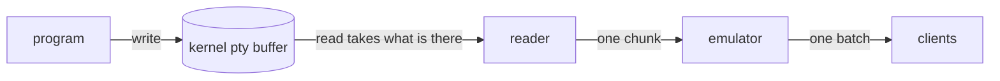
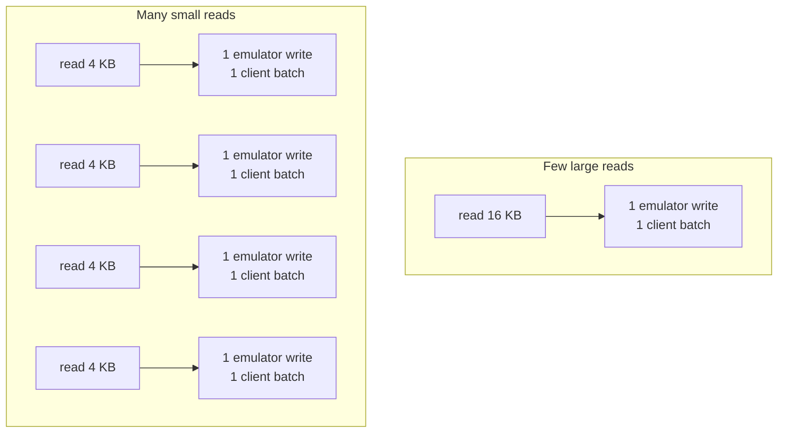
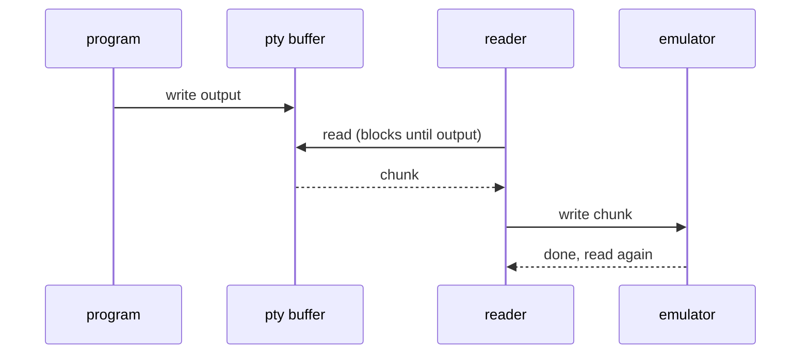
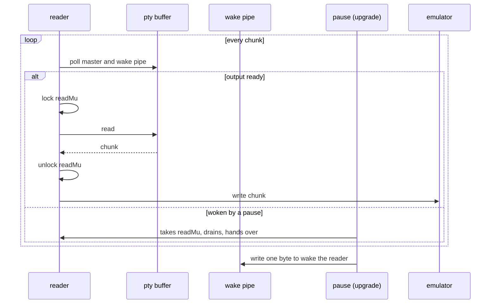
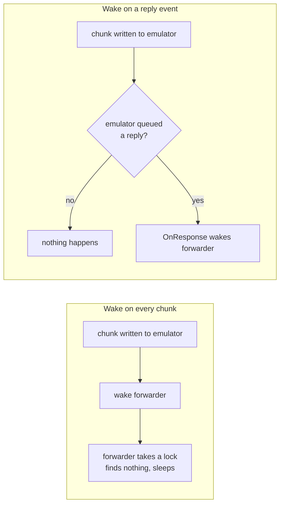
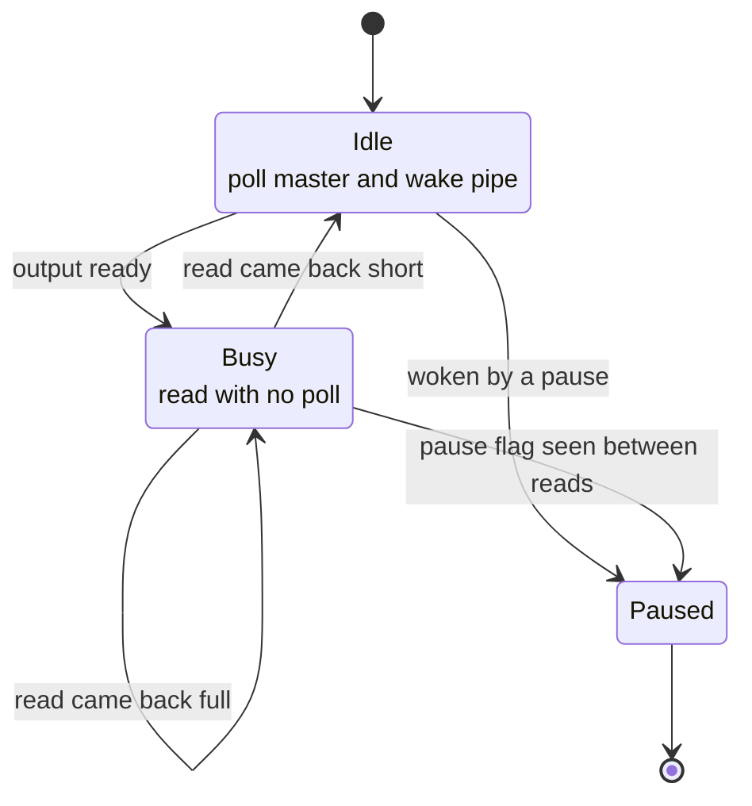
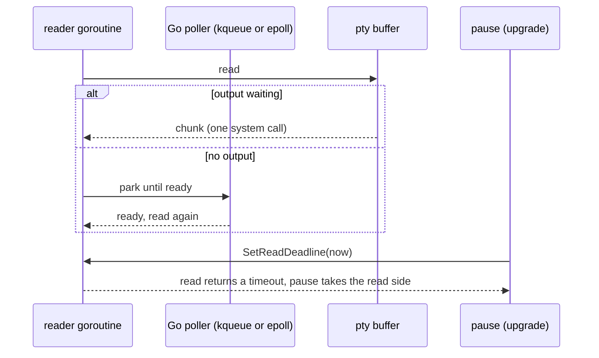
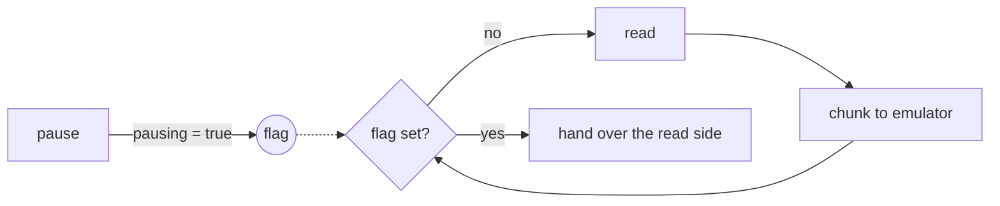
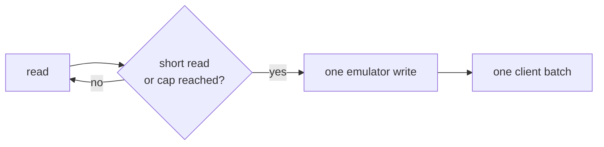
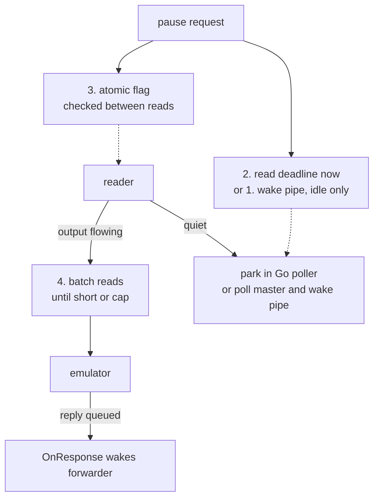

# Pane read path: the designs considered

A pane's output travels from the program, through the pty (pseudo-terminal), to the daemon's reader, the terminal emulator, and every attached client. A live upgrade has to pause that reader so the pane can be handed to the new daemon without losing or duplicating a byte. This note is the fork's record of the designs considered for that pause and how each fared when measured. The design in use, its per-platform behaviour and its numbers are in `docs/design/pane-read-path.md`, which ships with live handoff part 1 ([upstream PR #876](https://github.com/Gaurav-Gosain/tuios/pull/876)).

## Outcome

| Design | Result | Why |
|---|---|---|
| A kqueue per pane, registered once (macOS and the BSDs) | used | `poll(2)` on macOS builds and tears down a kqueue on every call: 631 ns a wait against 186 ns for `kevent(2)` on a kqueue kept open. It was 21% of the CPU profile. With the kqueue kept per pane, a 64 MiB flood costs 18.5 ms of CPU per MB against main's 18.4. |
| `poll(2)` before each read (Linux and other unix) | used | Cheap on Linux, about 0.3 ms per MB. |
| Reply forwarder woken by the emulator's `OnResponse` | used | An event, not a check: nothing runs when a chunk queues no reply. |
| 1. Busy versus idle | not used | No read ever fills the 16 KiB buffer on macOS or Linux, so it never triggers. |
| 2. Go's runtime poller | not used | Works on macOS and Linux, but is no cheaper on macOS, and `O_NONBLOCK` on the shared open file would make writes to the program fail with `EAGAIN` when its input queue is full. |
| 3. A flag between reads | not used | Cannot wake a reader that is already blocked, and the kqueue makes the wait cheap anyway. |
| 4. Batch before handing on | not used | The kernel sets the read size, so batching only adds latency. |

## What a read is

The program writes into the pty. The kernel holds those bytes in a small buffer until the reader takes them. A `read` returns whatever is in the buffer at that moment, up to the size the reader asked for. It does not wait for the buffer to fill.

So the size of each read depends on timing. A reader that comes back quickly finds a few bytes waiting. A reader that comes back later finds more. The total is the same, but the number of trips is not.

Every trip has a fixed cost that does not depend on how many bytes it carries: the system calls, a lock, one write into the emulator, and one batch encoded and sent to each client. More trips with fewer bytes each would mean more fixed cost for the same output.

On macOS the trip size is fixed by the kernel, not by the reader: the terminal output queue holds about 1 KiB, and 98.4% of reads return 1024 to 2047 bytes on main and with the read gate alike. So the number of trips is the same on both, and the cost of each trip's wait is what differs. The client batch count follows the reader's speed, not the read size: 604 a file on main, 656 with `poll` before each read, 621 with the kqueue.

## Main: one blocking read per chunk

The reader spends its idle time blocked inside `read`. Nothing else can take the pane's read side while it is blocked there, which is why a live upgrade cannot use this loop unchanged: a pause would wait for the program to print something.

## Live handoff part 1: a poll before every read

The reader now waits in `poll`, outside the lock, so a pause can always take the read side: it writes to the wake pipe, the poll returns, and the pause takes the lock. The cost is a second system call on every chunk. On macOS that call is expensive, because `poll(2)` builds and tears down a kqueue each time.

## The reply forwarder: a check versus an event

Some programs ask the terminal a question (its size, its colours) and wait for an answer. The emulator queues those answers and a forwarder writes them back to the program.

Part 1 checks after each chunk and wakes the forwarder only when a reply was queued. Part 8 goes further: the emulator's `OnResponse` callback wakes the forwarder, so the reader never asks at all.

## Four designs that drop the per-read check

### 1. Busy versus idle

Keep reading while reads come back full, because more output is almost certainly waiting. Go back to the poll only after a short read, when the program has gone quiet. This is the same switch Linux network drivers make between polling under load and waiting for an interrupt when idle.

The edge case is a burst that ends exactly on a buffer boundary: the read is full, so the reader reads again, and that read would block with no poll in front of it. A non-blocking read closes it: with no output waiting, the read returns at once and the reader goes back to Idle.

### 2. Go's runtime poller

Make the pty master non-blocking and let Go's runtime poller (kqueue on macOS, epoll on Linux) park the reader while there is no output. A pause sets a read deadline of now, which returns the parked read at once.

There is no extra system call per read and no wake pipe: the read is the event. It works only if the platform lets Go poll a pty master, which has to be checked on macOS and Linux before it is relied on.

### 3. A flag between reads

A pause sets an atomic flag, and the reader checks it after each chunk. That is a memory load, not a system call.

It cannot wake a reader that is already blocked, so it pairs with design 1 or 2 for the quiet case.

### 4. Batch before handing on

Read until a read comes back short, or a cap is reached, then write the whole batch into the emulator once. Fewer emulator writes means fewer client batches, which is the fixed cost behind the read phenomenon.

The cap keeps a program that never stops printing from starving the screen.

## How they combine

This combination was the starting hypothesis. Measured, the wait before each read stays, because every read on macOS is short and the reader really does wait once per KiB. What changed is the wait itself: one `kevent` on a kqueue kept per pane, in place of a `poll` that builds a kqueue each time. The pause guarantee holds either way: a pause never waits on a quiet program, which `TestQuiesceAfterBurstDoesNotWait` checks after an 8 MiB burst.
